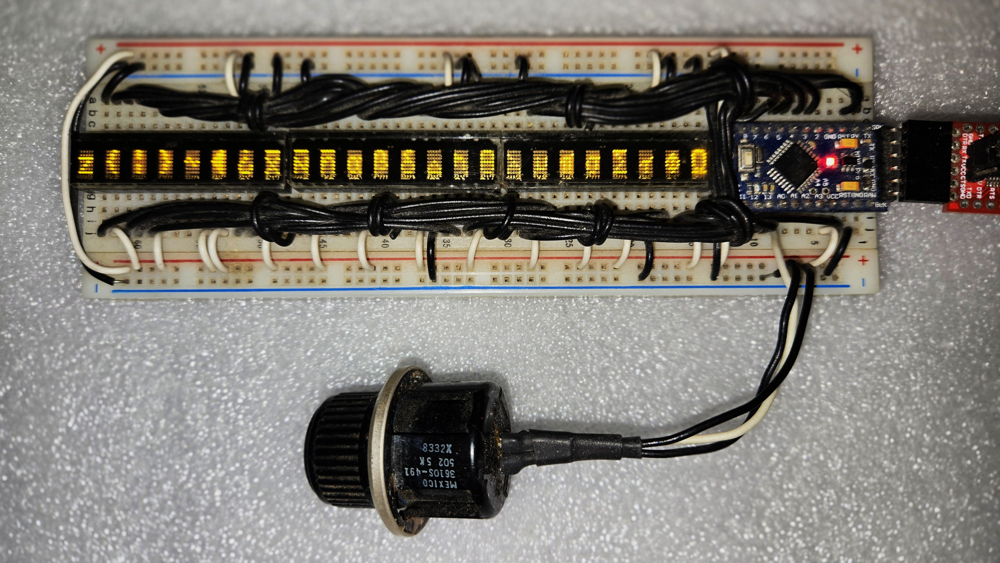

# new_3_bank_display_test

**Project page:** https://k9dtv.com/project-3-bank-display.html  
**Sister project (original 2013 sketch):** [3_bank_display_test](https://github.com/K9DTV/3_bank_display_test)

Same hardware as the 2013 breadboard: **OSEPP / Arduino Pro Mini** (ATmega328, 5 V, 16 MHz) driving **three PDSP1880** LED character displays with a pot on **A0** for scroll delay.

This repo is a **structure rewrite** of that sketch. Bus timing, bank selects, charset (`0x00`..`0x7E`), and scroll behavior match the original. Changes:

- Named constants instead of magic hex
- Small helpers for bank select, digit write, and scroll wrap
- Scroll delay range is a real **20..500 ms** (`map()` into `int`; the original used `byte(500)`, which truncated to 244)

Sketch: `new_3_bank_display/new_3_bank_display.ino`

*Same breadboard / wiring as the original project (photo from the 2013 build).*

## Hardware

| Item | Detail |
|------|--------|
| MCU | OSEPP / Arduino Pro Mini - ATmega328 @ 5 V, 16 MHz |
| Displays | 3x PDSP1880 (left master + two slaves) |
| Scroll control | Potentiometer wiper on **A0** |
| Power | +5 V (`VIN`) and GND |

## Pin map

| Pro Mini | Port | Function |
|----------|------|----------|
| D0..D6 | PD0..PD6 | Display data bits |
| D7 | PD7 | Display WR (active low) |
| D8..D10 | PB0..PB2 | Digit address A0..A2 |
| D11 | PB3 | Bank select 1 (left) |
| D12 | PB4 | Bank select 2 (middle) |
| D13 | PB5 | Bank select 3 (right) |
| A0 | PC0 | Scroll-speed pot wiper |

D0/D1 are data lines, so hardware Serial is not available.

## Schematic

Shared data / WR / digit address to all three modules; D11/D12/D13 are individual bank selects.

## Build and upload

1. Open `new_3_bank_display/new_3_bank_display.ino` in the Arduino IDE (no external libraries).
2. Board: **Arduino Pro or Pro Mini**, processor **ATmega328P (5 V, 16 MHz)**.
3. Wire as in the schematic / pin map (same as the original).
4. Upload and turn the pot to adjust scroll speed.

GitHub Actions compiles this sketch on every push to `master` (compile check only).

## License

MIT -- see `LICENSE`.
